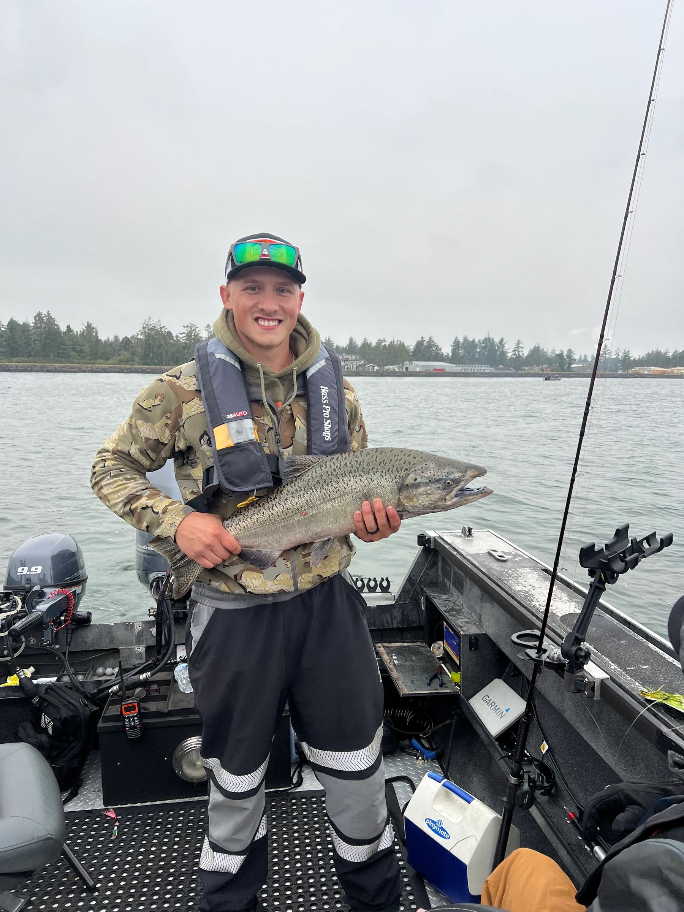
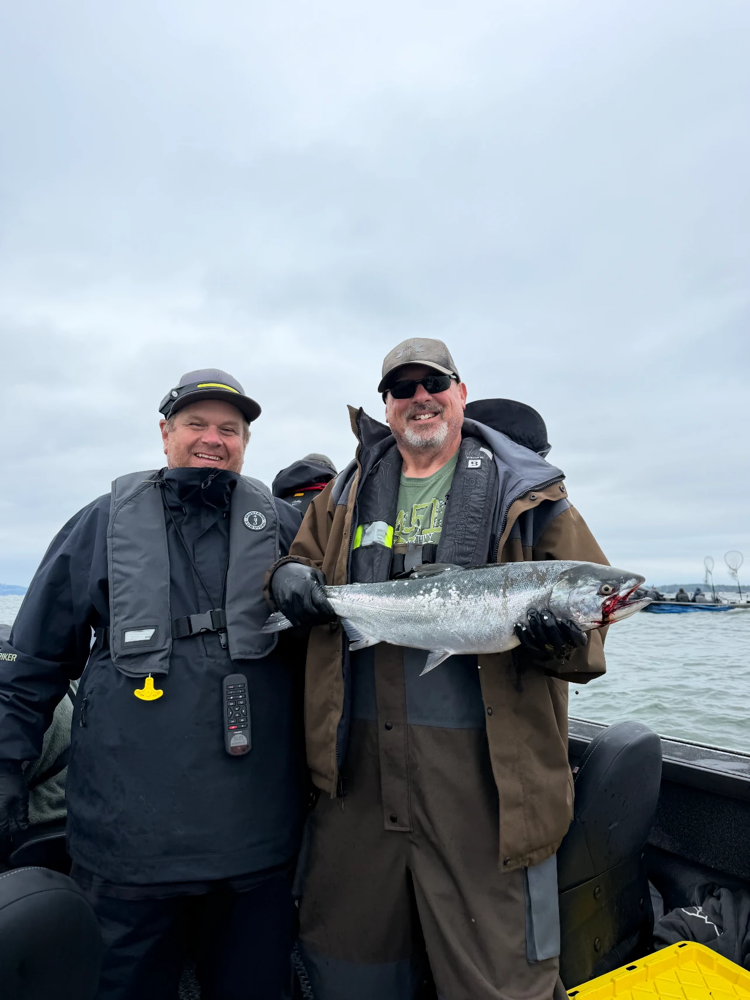
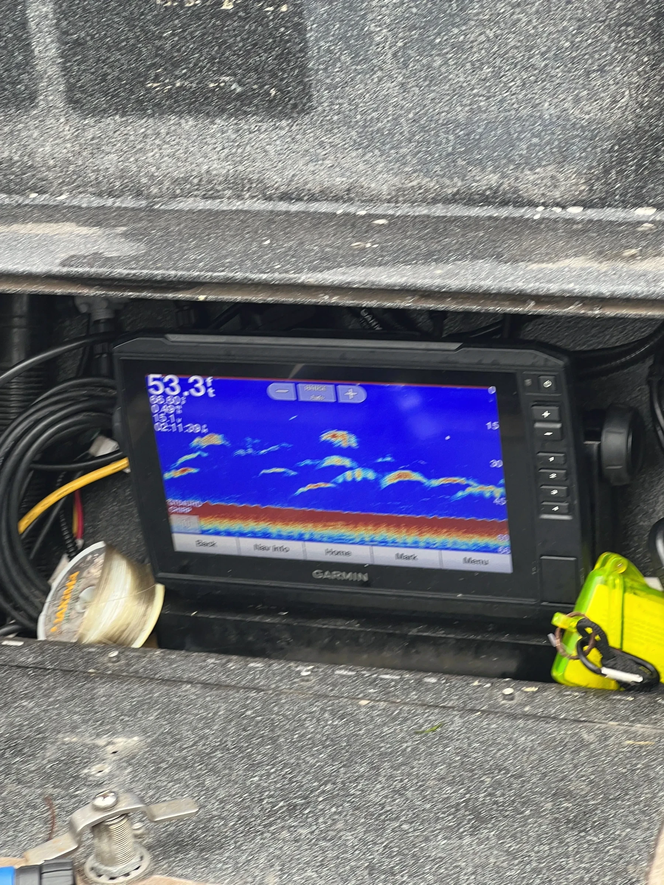
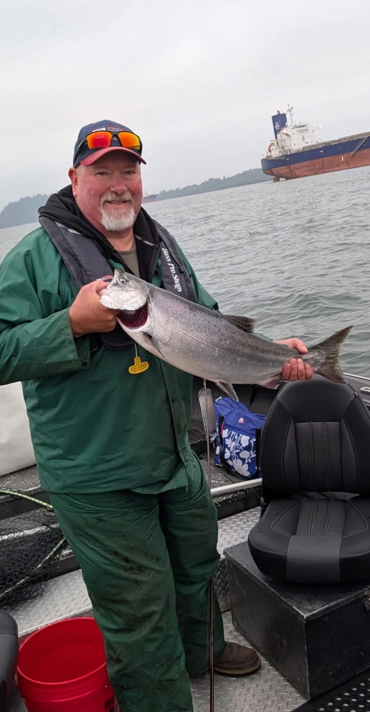
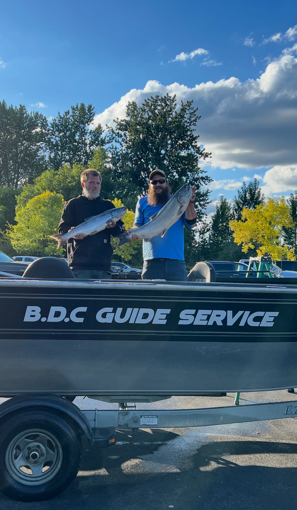

<!--
Provenance: trip prices, lengths, boats, capacities and inclusions are from src/data/trips.ts. Seasons are from
src/data/seasons.ts. Deposit, balance, cancellation, what to bring, tipping, the 4:00 AM start and the meeting
spot are from src/data/policies.ts and the FAQs in src/data/content.ts. The opening detail is from the Google
review in src/data/reviews.ts (transcribed 16 Oct 2026, truncated by the dashboard, so only the visible words
are used). License and endorsement rules are from the ODFW pages linked in the text, read 28 Oct 2026. Forecast
links are from the NWS Portland page, read 28 Oct 2026.
Open items for the captain are marked NEED FROM CLIENT. Resolve them before draft: true is removed.
-->

A couple who fished with Captain Clinton out of Astoria wrote a Google review that thanks him for being professional and patient with the wife. That one word, patient, is what a first-timer wants to hear.

If you are booking your first fishing charter in Oregon, you probably have the same questions they did. What do I need before I show up? What does the day look like? What if I have never held a rod? This is the order a trip runs in, from the booking to the dock, with the parts that surprise people called out.

## Before you go: your first fishing charter in Oregon starts at home

Two things happen before the boat leaves the dock. You book, and you sort out your license.

Booking means picking a trip and a boat. A full day is 8 hours at $250 per person, and a half day is 4 hours at $150. If eight hours feels long for a first outing, the half day is the easier start. The Willie Predator seats up to 6 anglers and is often limited to 4 for comfort, and the 16 foot Alumaweld drift boat takes up to 3 guests. Our [guide to which boat you will be on](/article/which-boat-will-you-be-on) explains the difference, and the [trips and rates page](/oregon-fishing-charter-rates) lists every trip.

A deposit is required for every booking and is applied at checkout. The balance is due on the trip date, as credit or cash.

Then the license, which nobody can hand you at the dock. Oregon requires one for anyone 12 or older, and [ODFW sells them online](https://myodfw.com/articles/how-buy-oregon-fishing-license). Children younger than 12 do not need one. Every angler also needs a valid angling tag. If you will fish for salmon, steelhead or sturgeon in the Columbia River Basin, you need a [Columbia River Basin Endorsement](https://myodfw.com/articles/who-needs-columbia-river-basin-endorsement) as well, whether you keep the fish or release it. Several of the rivers Captain Clinton fishes are in that basin, so ask him when you book. Our page on the [Oregon fishing license](/article/get-your-valid-oregon-fishing-license) walks through it.

## Pick the right month

What you catch depends on when you come. Captain Clinton gives these windows:

- Winter steelhead, January through April
- Spring and early Chinook, March through July
- Fall salmon, August through November
- Dungeness crab charters, October through December

American shad and catch-and-release sturgeon are also on the list, and he has not set months for shad. Shad come through in numbers, which is why he calls them one of the best trips for kids and first-time anglers. The [month-by-month guide](/article/when-to-fish-oregon-month-by-month) has the detail, and runs shift with the river and the year, so call before you plan around a date.

If you are reading this in late October, the windows that are open now are fall salmon, which runs through November, and crab charters, which run through December. Winter steelhead opens in January, so a first trip in the new year has a different set of fish on the line than one booked this month.

## The night before

Check the weather. A boat day is a weather day, and the forecast decides what you wear and whether the trip runs. The National Weather Service office in Portland posts [coastal marine forecasts](https://www.weather.gov/pqr/marine) and small craft advisories, and a [rivers and lakes page](https://water.noaa.gov/wfo/pqr) for river conditions.

Then pack. The guide, the boat, rods, reels, tackle and bait are all included, with live bait when it applies. You bring a hat, sunscreen, polarized sunglasses, clothing for the weather, and food and drinks. Layers you can peel off as the sun comes up work better than one heavy coat. The full [packing list](/article/what-to-bring-on-an-oregon-fishing-charter) is here, and you are welcome to bring your own rod.

Plan for an early alarm. Trips can start as early as 4:00 AM, most often for salmon, because early morning is the most productive stretch. Captain Clinton gives you the exact meeting spot and launch time when you book, since both change with the season and the river. Put it in your phone the night before.

## On the water

You do not need to know anything. Rods and reels are provided, and the captain runs the boat.

On a crab trip, he shows you how to bait a pot and how to tell a keeper from the ones that go back. Keepers are male Dungeness crab at least 5¾ inches across the shell, and female crabs always go back. There is a seasonal rule too: Oregon's ocean waters are closed to crabbing from October 16 to November 30, while bays and estuaries stay open all year, according to [ODFW's shellfish rules](https://myodfw.com/articles/oregon-shellfish-regulations).

Expect to spend a lot of the morning waiting, and that is normal. Fishing is mostly patience with a few busy minutes in it, and a first-timer who knows that going in tends to enjoy the quiet stretches more. Bring something to drink and eat, since food and drinks are on your list, and keep them in a bag you can reach without leaving your seat. The Garmin sonar screen on the console is how the captain reads the water, and it is worth asking him what it shows.

Group size matters here, and it is the one choice you control. Four or more people puts you on the Predator, and three or fewer can go on either boat. Whoever is newest to fishing should not be the person who has to ask for help, so say so at the start and let the captain plan around it. A smaller boat means more of the captain's attention for each guest. If anyone in your party is new to fishing, tell him your group size and what you are hoping to catch when you book.

## If the weather says no

Weather is the part of a first trip people worry about most. If Captain Clinton has to cancel because of weather, health or equipment, you can reschedule for a later date or take a refund of your deposit.

If you need to cancel, do it 7 days before your trip date to get your deposit back. Rescheduling is encouraged and depends on the guide's availability. [NEED FROM CLIENT: how he decides on a weather call, and how far ahead guests hear]

## Back at the dock

The balance comes due on the trip date, by credit or cash. Tipping is customary at 20% of the trip total, so for two guests on a full day, that is $500 for the trip and $100 for the tip.

If you keep fish, you need a way to get it home, and a cooler in the car is the simple answer. [NEED FROM CLIENT: whether fish are cleaned and bagged on the boat or at the dock, and anything guests should know about taking fish home]

See what other days looked like in the [gallery](/oregon-fishing-charter-photos), and read what past guests wrote on the [reviews page](/oregon-fishing-charter-reviews).

## Frequently asked questions

### Do I need experience to book a charter?

No. Rods, reels and tackle are provided, and the captain handles the setup. Tell him when you book that it is a first trip.

### Do kids need a license?

Not under 12, according to ODFW. Anyone 12 or older needs one, and every angler of any age needs an angling tag and follows the rules on recording harvest.

### What time does the trip start?

As early as 4:00 AM, most often for salmon. Captain Clinton confirms the time and the meeting spot when you book.

### What should I wear?

Weather-appropriate clothing, a hat, sunscreen and polarized sunglasses. Layers are the safe answer on an early start.

### What if the weather is bad?

If the captain cancels for weather, you can reschedule or get your deposit back. If you cancel, do it 7 days before the trip to get yours back. More answers are on the [FAQ page](/fishing-faqs).

<a class="btn btn--primary" href="/contact-us">Request your first trip</a>

