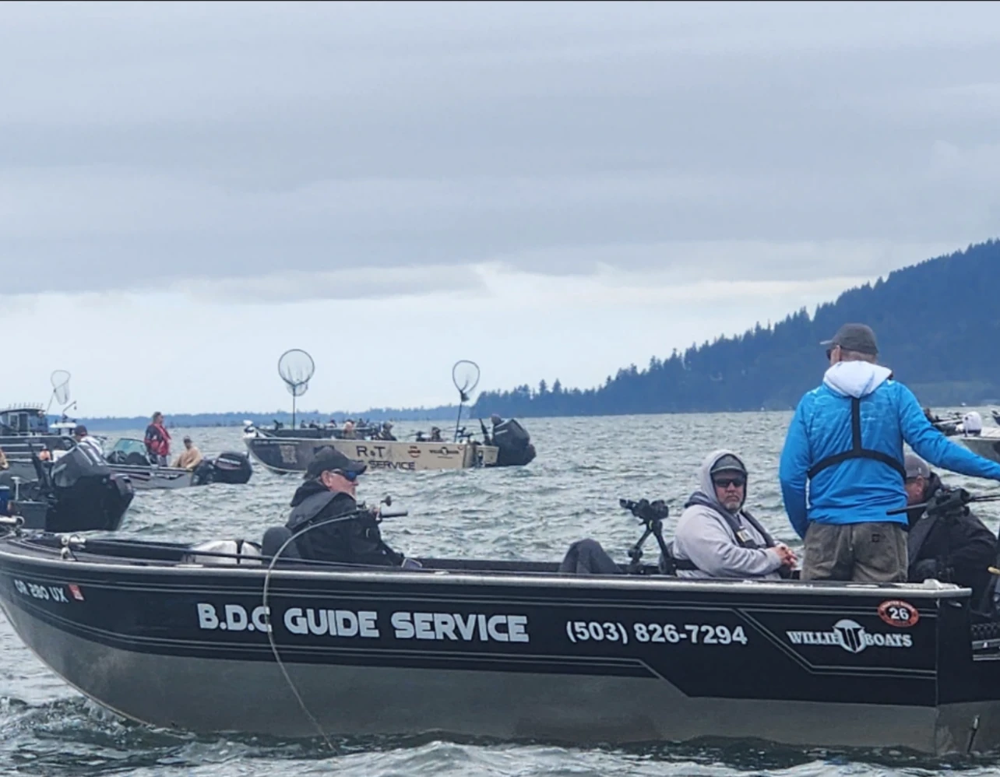
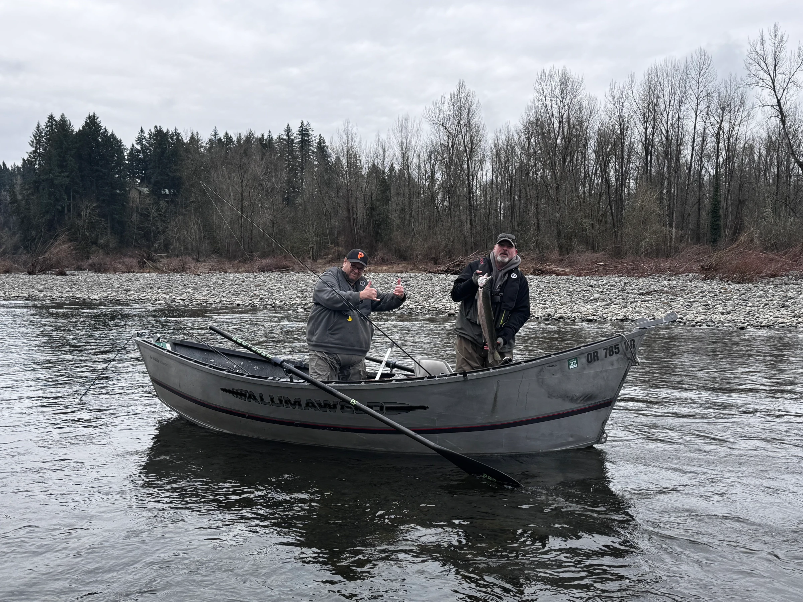
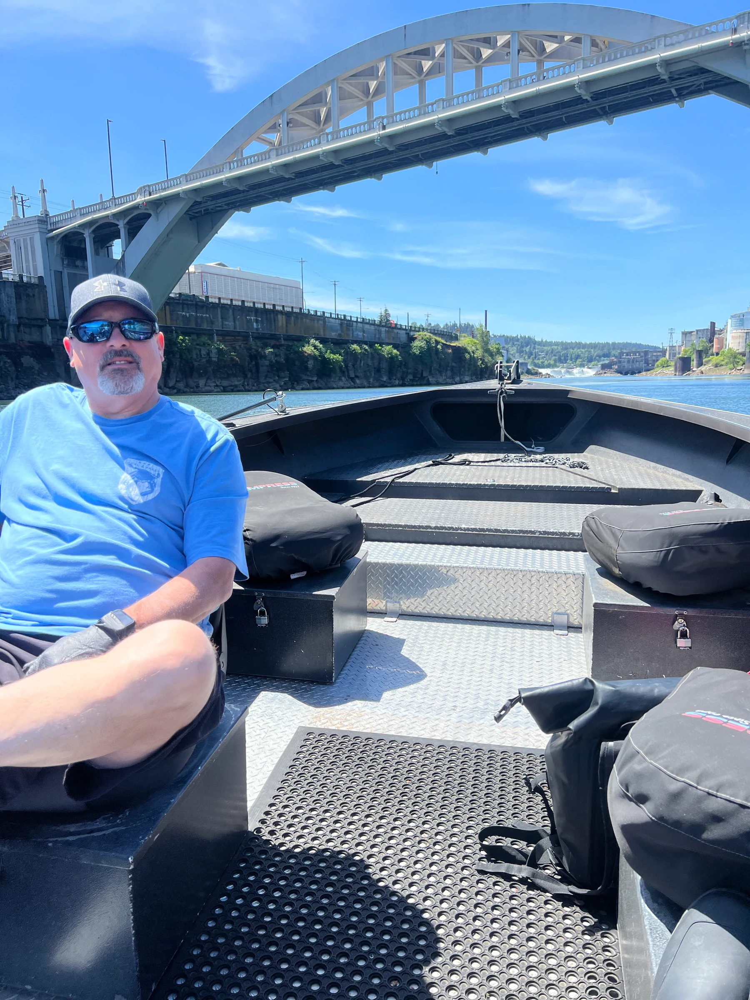
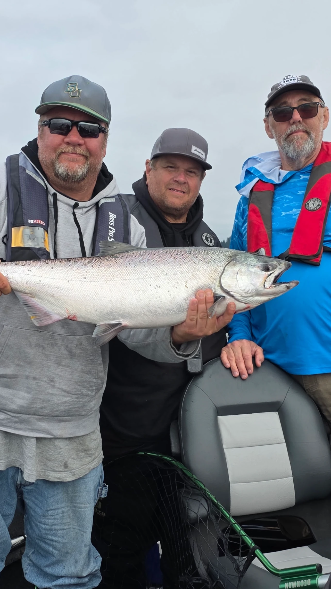

<!--
Provenance: boats, capacities, prices, trip lengths and what is included come from src/data/trips.ts.
Seasons are from src/data/seasons.ts. Deposit, balance, cancellation, what to bring and tipping are from
src/data/policies.ts and the FAQs in src/data/content.ts. The credentials line is from src/data/site.ts.
The review detail and the 5.0 / 3 reviews figure are from src/data/reviews.ts (Google, checked 16 Oct 2026).
Licence, endorsement and crab rules are from the ODFW pages linked in the text, read 27 Oct 2026.
Open items for the captain are marked NEED FROM CLIENT and must be resolved before draft: true is removed.
-->

A guest who fished with Captain Clinton in early August left a Google review that begins with a small detail. He arrived early, and the captain was already in the boat and ready.

It is an ordinary thing to notice. It is also a fair place to start if you are working out how to choose a fishing charter in Oregon, because the day is usually decided by small things like that, and by whether a few plain questions get plain answers.

Here are seven to ask any charter before you pay a deposit. Each one comes with the way Best Days Catching, run by BDC Guide Service, answers it, so you can see what a straight answer sounds like. Ask the same seven of everyone you are comparing. A good captain will not mind.

## How to choose a fishing charter in Oregon: seven questions

The list runs in the order most people need it: who is running the boat, what you can catch, who fits aboard, what you pay for, when you show up, what it costs in the end, and what happens if plans change.

Write the answers down as you go, one column per charter. Two captains can both say "salmon" and mean very different days, and the notes are what let you compare them fairly a week later, when the details have blurred.

### 1. Is the captain licensed and insured?

Ask for the license type and for proof of insurance. A working captain has both on hand and will tell you without a pause.

Captain Clinton McCulloch is US Coast Guard certified, fully licensed and insured for guided fishing in Oregon. [NEED FROM CLIENT: credential type and number (OUPV "six-pack" or Master, MMC number) and ODFW outfitter-guide registration number]

Then read what past guests wrote. The [Google reviews on this site](/oregon-fishing-charter-reviews) show 5.0 stars from 3 reviews as of October 16, 2026. That is a small number, so read the words and not just the stars.

### 2. What will we be fishing for in the month I am coming?

This is the question that separates a good trip from a disappointing one. Fish run in windows, and a charter that says "salmon" without a month is not telling you much.

Captain Clinton gives these windows:

- Winter steelhead, January through April
- Spring and early Chinook, March through July
- Fall salmon, August through November, with fall Chinook strongest August through October
- Dungeness crab charters, October through December

He also fishes American shad and catch-and-release sturgeon. He has not set months for shad, so call for dates. Runs shift with the river and the year, and the [month-by-month guide](/article/when-to-fish-oregon-month-by-month) goes through each one.

Crab has a rule worth knowing. Oregon's ocean waters are closed to crabbing from October 16 to November 30, while bays, beaches, estuaries and jetties stay open all year, according to [ODFW's shellfish regulations](https://myodfw.com/articles/oregon-shellfish-regulations). If you book crab in that window, ask where the trip will fish.

### 3. What boat will we be on, and how many people fit?

Boat size changes who can come and where you can fish, so it is worth asking before you book for a group.

Best Days Catching runs two boats. The 22 foot Willie Predator seats up to 6 anglers, though Captain Clinton often limits it to 4 so nobody is elbow to elbow. The 16 foot Alumaweld drift boat takes up to 3 guests and is built for shallow water.

Bigger is not automatically better. The right boat is the one that fits your group and the water you will be on. Our short guide to [which boat you will be on](/article/which-boat-will-you-be-on) lays out the trips for each.

### 4. What is included, and what do I need to arrange myself?

Ask for the list in writing, and ask what is not on it.

On a Best Days Catching trip, the guide, the boat, rods, reels, tackle and bait are included, with live bait when it applies. Crab charters include the guide, the boat and all necessary equipment. You are welcome to bring your own rod.

You bring a hat, sunscreen, polarized sunglasses, clothing for the weather, and food and drinks. The [packing list](/article/what-to-bring-on-an-oregon-fishing-charter) has the detail.

The one thing nobody can hand you at the dock is your fishing license. Oregon requires one for anyone 12 or older, and [ODFW explains how to buy one online](https://myodfw.com/articles/how-buy-oregon-fishing-license). Salmon, steelhead or sturgeon in the Columbia River Basin also need a [Columbia River Basin Endorsement](https://myodfw.com/articles/who-needs-columbia-river-basin-endorsement), for catch and release as well as for fish you keep. Our page on the [Oregon fishing license](/article/get-your-valid-oregon-fishing-license) covers the steps.

### 5. Where and when do we meet?

A charter that cannot say where it launches is a charter that has not planned your day. You also want to know how early to wake up, because a fishing morning can start before the sun does, and it helps to plan the drive and the night before around that.

Captain Clinton gives you the exact meeting spot and launch time when you book, because both change with the season and the river. Trips can start as early as 4:00 AM, most often for salmon, when early light is the most productive part of the day. He fishes the Columbia, Willamette, Wilson, Trask, Sandy, Clackamas and Nestucca rivers, depending on the season and where fish are biting.

### 6. What will it cost in total?

The rate on a website is rarely the whole bill, so ask about the deposit, the balance and the tip.

Best Days Catching charges per person: a full day of 8 hours is $250, a half day of 4 hours is $150, and a 5 hour crab trip is $150. A deposit is required for every booking and is applied at checkout. The balance is due on the trip date, as credit or cash.

Tipping is customary at 20% of the trip total. For two guests on a full day, that is $500 for the trip and a tip of $100. The full list is on the [trips and rates page](/oregon-fishing-charter-rates).

### 7. What happens if the weather turns or plans change?

Ask for the cancellation terms before you hand over a deposit, and ask what the captain does when conditions are poor. Oregon rivers and coastal weather change with the season, and a trip planned months ahead may meet a very different morning than the one you pictured. What matters is that the rules are stated before you pay, not after.

If you need to cancel, do it 7 days before your trip date to get your deposit back. Rescheduling is encouraged and depends on the guide's availability. If Captain Clinton has to cancel for weather, health or equipment, you can reschedule for a later date or take a refund of your deposit.

## Frequently asked questions

### Do I need my own fishing license on a guided trip?

Yes. Oregon requires a license for anyone 12 or older, plus a valid angling tag, and ODFW says children younger than 12 do not need one. Buy yours at [myodfw.com](https://myodfw.com/articles/how-buy-oregon-fishing-license) before the trip, not at 4 AM on the way to the launch.

### Do I need to bring my own gear?

No. Rods, reels and tackle are provided, along with bait on fishing trips. Bring your own rod if you prefer it.

### How early do trips start?

As early as 4:00 AM, especially for salmon. Captain Clinton adjusts start times for the season and the species and confirms yours when you book.

### Are trips good for kids and first-timers?

Captain Clinton points to American shad as one of the best trips for kids and first-time anglers, because they come through in numbers. Tell him your group's ages when you book, and he will say what fits. [NEED FROM CLIENT: any minimum age or kid-specific rules, since none are published]

### What if I need to cancel?

Cancel 7 days before your trip date and your deposit is refunded. More detail is on the [FAQ page](/fishing-faqs).

<a class="btn btn--primary" href="/contact-us">Request your trip</a>

